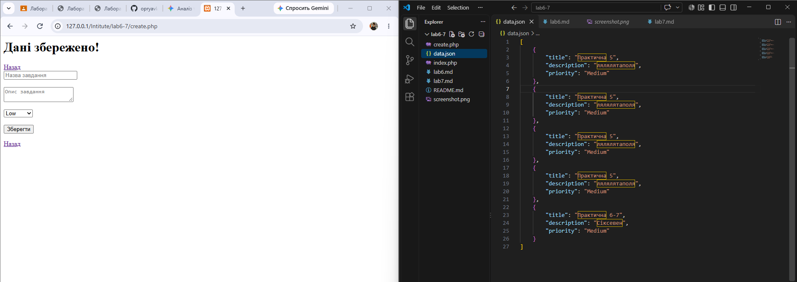

# Звіт до Лабораторної роботи №6

## 1. Блок коду з формою
```html
<form action="create.php" method="POST">
    <input type="text" name="title" placeholder="Назва завдання" required>
    <textarea name="description" placeholder="Опис завдання" required></textarea>
    <select name="priority" required>
        <option value="Low">Low</option>
        <option value="Medium">Medium</option>
        <option value="High">High</option>
    </select>
    <button type="submit">Зберегти</button>
</form>
```
## 2. 

## Відповіді на контрольні запитання
1) 3 ключові відмінності між GET та POST:

Передача даних: GET передає дані у відкритому вигляді через URL (Query String), POST — у тілі HTTP-запиту.
Обмеження за розміром: GET обмежений максимальною довжиною URL (близько 2048 символів), POST практично не має обмежень.
Кешування та безпека: GET-запити кешуються браузером і зберігаються в історії, POST не кешується і використовується для зміни стану даних на сервері.
2) Коли прийнятний GET і чому не можна передавати паролі:

GET прийнятний для пошукових запитів, фільтрації та пагінації, де користувач має можливість зберегти сторінку в закладки або поділитися посиланням.
Паролі передавати GET-методом не можна, оскільки вони зберігаються у відкритому вигляді в історії браузера, логах сервера та передаються в заголовку Referer.
3) Призначення атрибута action:

Вказує URL-адресу або шлях до файлу на сервері, куди будуть відправлені дані форми після її сабміту.
4) Критерій асоціації даних PHP з ключами $_POST:

PHP асоціює дані за значенням атрибута name відповідного HTML-тегу (<input>, <textarea>, <select>).
5) Призначення var_dump() та <pre>, використання в Production:

var_dump() виводить тип та значення змінної для відлагодження коду.
Тег <pre> зберігає форматування (пробіли та переноси рядків) для зручного читання виводу.
У Production-середовищі цей код не використовується, оскільки це розкриває внутрішню структуру даних зловмисникам та псує інтерфейс.